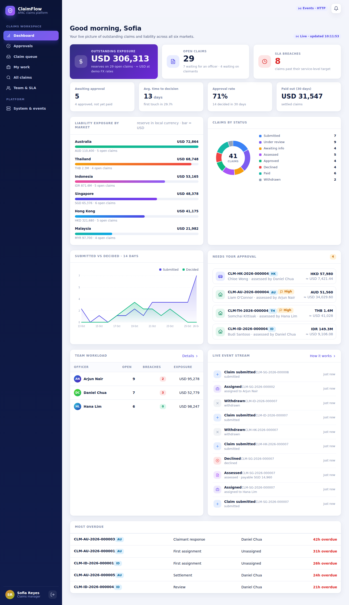
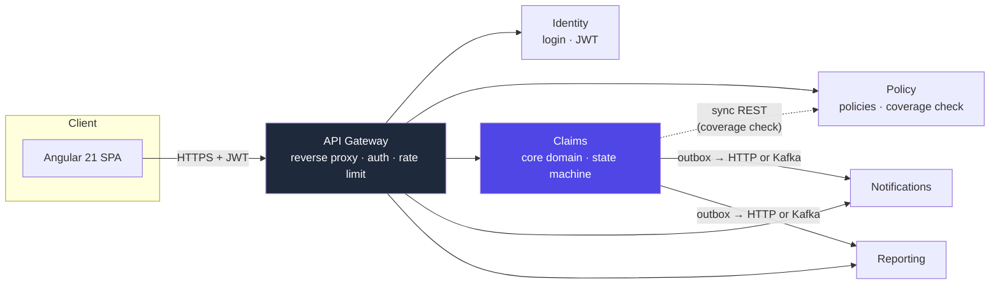
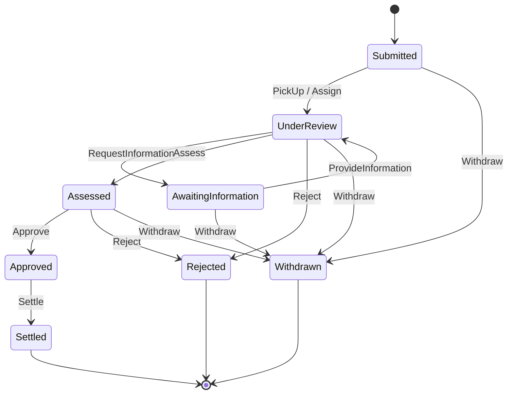
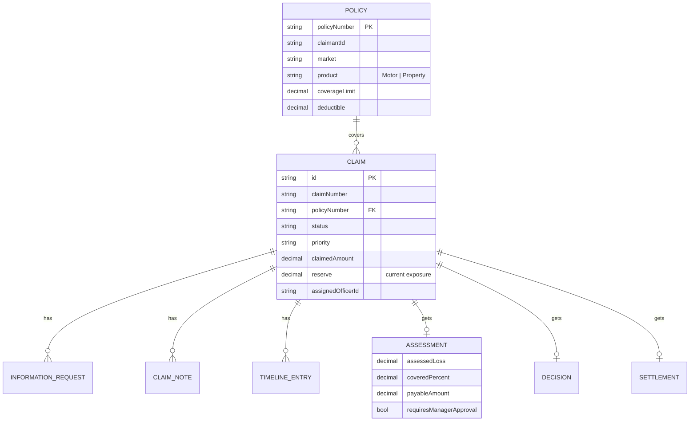
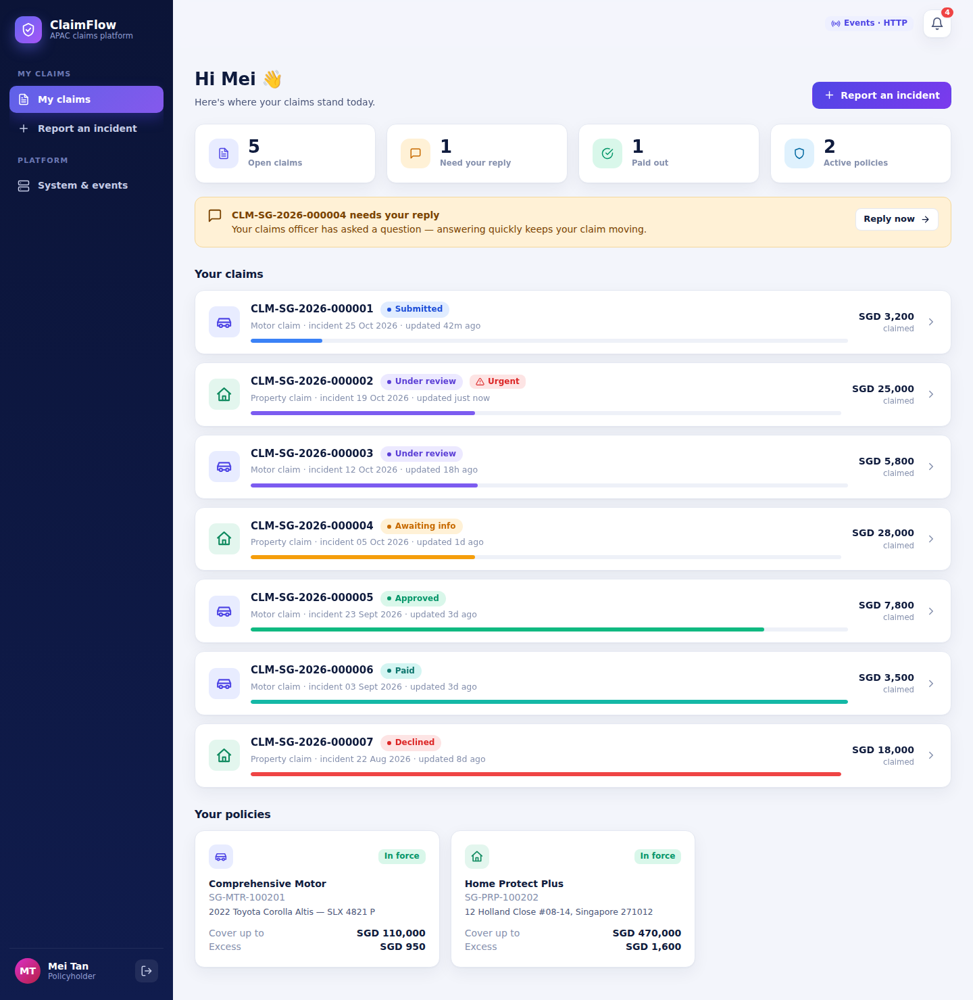
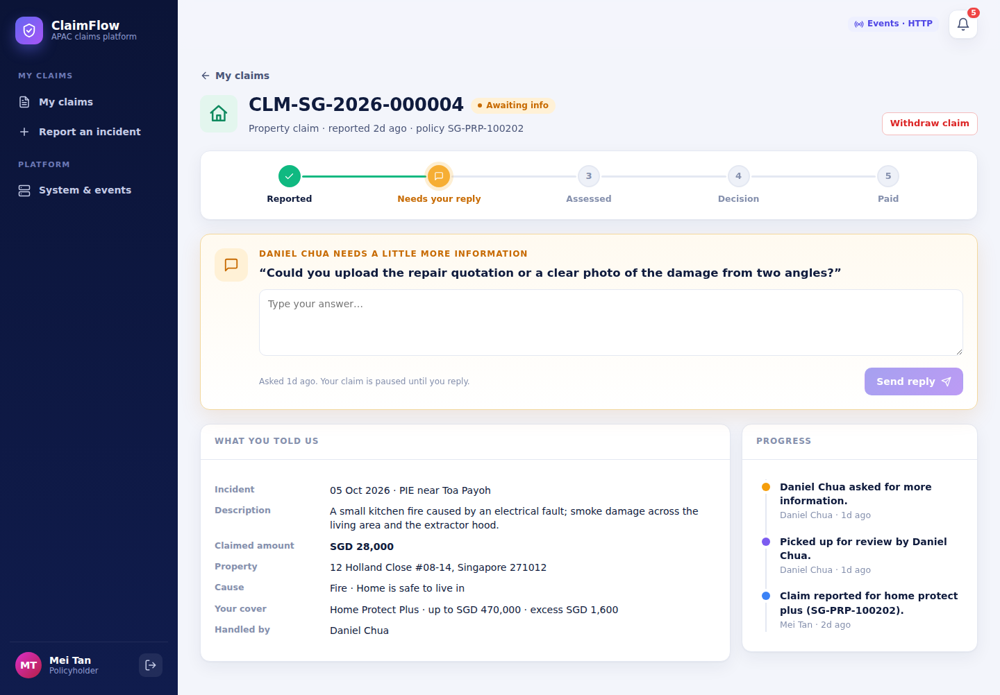
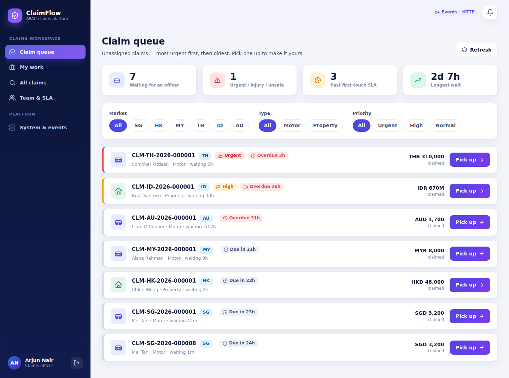
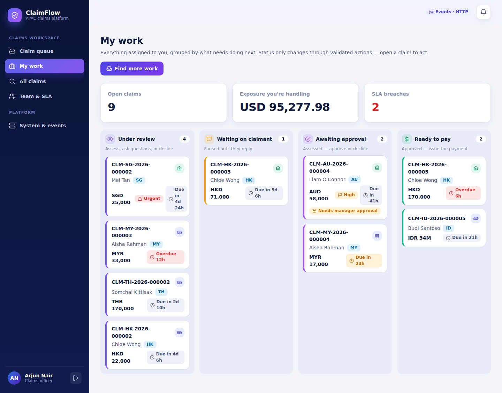
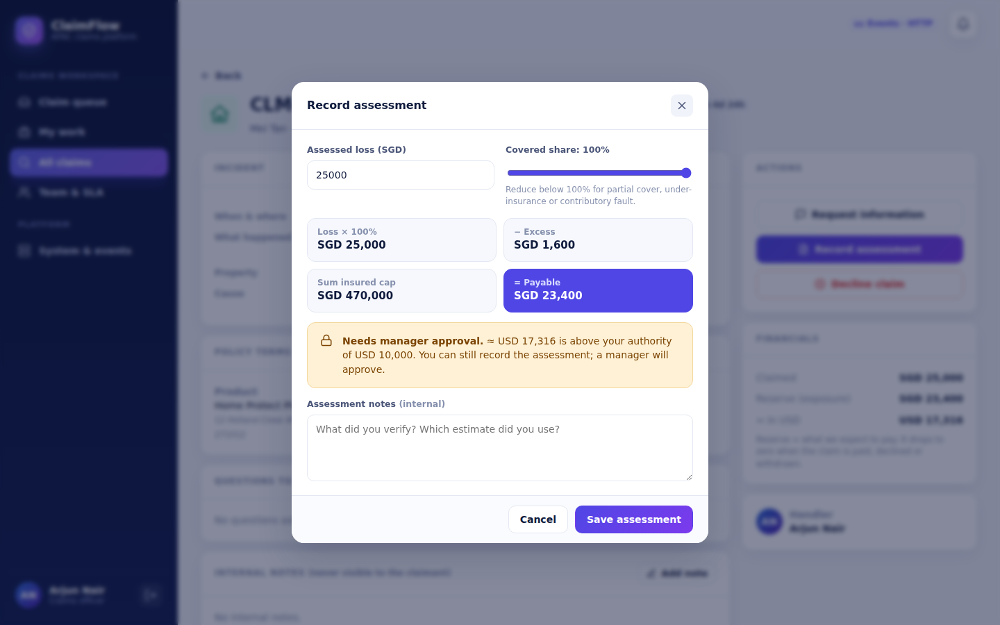
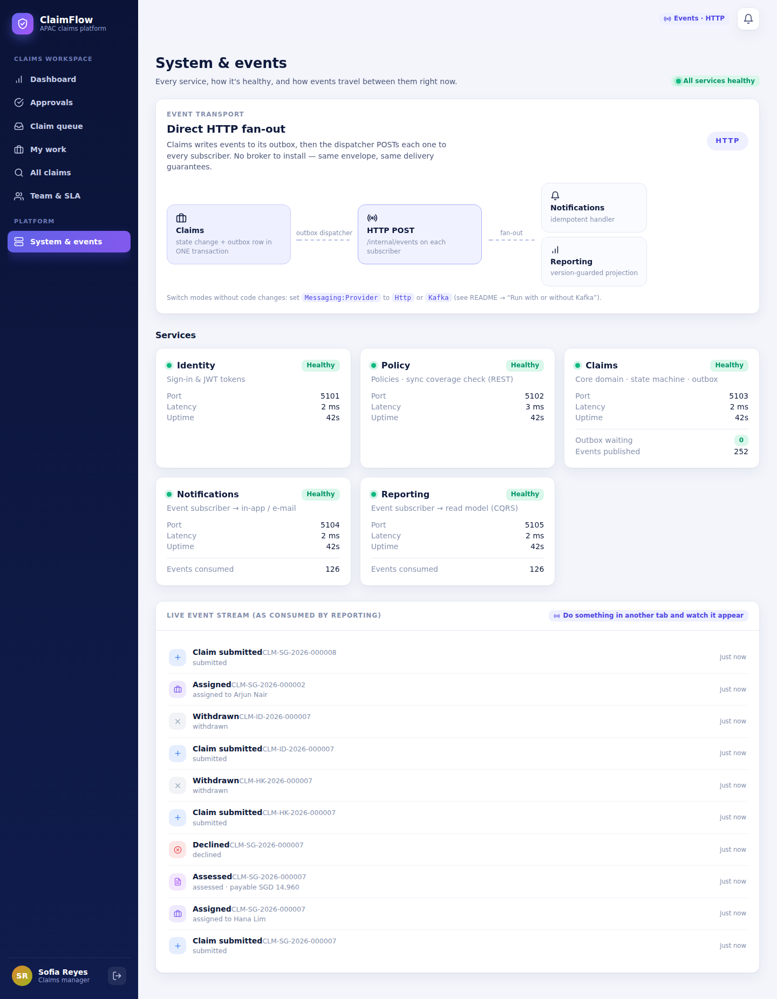

# 🛡️ ClaimFlow — APAC Claims Platform

> **Take-home assessment — Backend Developer, Chubb APAC Engineering**
> A microservices backend (plus a full Angular frontend, built beyond the brief) for reporting, assessing and
> settling motor and property claims across six APAC markets — Singapore, Hong Kong, Malaysia, Thailand,
> Indonesia and Australia.

| | |
|---|---|
| **Backend** | .NET 9 · 6 microservices · event-driven (transactional outbox) |
| **Frontend** | Angular 21 (standalone components, signals) |
| **Messaging** | Switchable: plain **HTTP fan-out** (zero setup) or **Apache Kafka** (KRaft, no Docker) |
| **Database** | Embedded transactional JSON document store — one file per service, no install needed |
| **Auth** | Hand-rolled HS256 JWT (zero auth NuGet packages — see [AI_JOURNAL.md](./AI_JOURNAL.md)) |
| **Tests** | 61 xUnit tests — domain rules, platform plumbing, projections |
| **Run it** | `./scripts/start.sh` *(or `.ps1` on Windows)* — see [Getting started](#-getting-started) |

<p align="center"></p>

---

## 📖 Table of contents

1. [What this is](#-what-this-is)
2. [Architecture](#-architecture)
3. [Service boundaries — why these six](#-service-boundaries--why-these-six)
4. [The claim lifecycle](#-the-claim-lifecycle)
5. [Communication: REST vs. Kafka](#-communication-rest-vs-kafka)
6. [Data model](#-data-model)
7. [Screens](#-screens)
8. [Getting started](#-getting-started)
9. [Demo accounts](#-demo-accounts)
10. [Project structure](#-project-structure)
11. [Testing](#-testing)
12. [What I'd do with more time](#-what-id-do-with-more-time)
13. [Honest limitations](#-honest-limitations)

---

## 🎯 What this is

Chubb APAC processes motor and property claims across six markets. The brief: design and build **the backend**
that lets a claimant report an incident, track it, and get paid — and lets claims staff pick up work, assess it,
and see their team's workload and liability exposure. The brief said the frontend was out of scope; I built one
anyway so the backend's behaviour is easy to see and verify, not just to read about.

**Three roles, three very different jobs:**

| Role | Can do |
|---|---|
| 🧑‍💼 **Claimant** | Report an incident, track status, answer questions from staff, see the decision, withdraw |
| 🕵️ **Claims officer** | Pick up claims, request information, assess loss, approve/reject (within their authority), settle payment |
| 📊 **Manager** | Everything an officer can, plus: approve claims above an officer's authority, see exposure & SLA across all markets |

---

## 🏗 Architecture



* **Gateway** — the only public door. Enforces JWT on everything except `/login`, rate-limits, and proxies
  `/api/{service}/...` to the right place. A hand-rolled `HttpClient` proxy (YARP would be the production
  choice — see the journal for why I didn't reach for it here).
* **Identity** — issues and validates JWTs. Stateless; any instance can validate any token.
* **Policy** — owns the policy book. Exposes a **synchronous** coverage check (`GET /policies/{n}/coverage`)
  that Claims calls at intake — a claimant needs a yes/no *now*, not eventually.
* **Claims** — the core domain. Owns the state machine, the approval-authority rule, and the only place a
  claim's reserve (financial exposure) is calculated. Publishes every state change as an event.
* **Notifications** / **Reporting** — pure event subscribers. Neither ever calls Claims back; they rebuild
  everything they need from the event stream (event-carried state transfer). Reporting is the read model
  behind the manager dashboard and the Team & SLA page.

Every service that isn't Identity owns its **own** data file under `data/` — database-per-service, just
embedded instead of a separate process.

---

## 🧩 Service boundaries — why these six

The brief asks: *is this one service or more than one? What drives that decision?* My answer, briefly (the
full reasoning, including what I rejected, is in [AI_JOURNAL.md](./AI_JOURNAL.md)):

| Driver | Decision |
|---|---|
| **Different read/write profile** | Policy is read-heavy and rarely written; Claims is write-heavy with complex rules. Splitting them means each can be reasoned about (and scaled) independently. |
| **Different consistency needs** | Coverage checking must be synchronous and strongly consistent (don't accept a claim on a lapsed policy). Telling a manager "exposure is ~2 seconds stale" is perfectly fine. That difference is the line between REST and events. |
| **Different audiences, different blast radius** | Notifications and Reporting can be down, slow, or being redeployed without claimants or officers noticing — because they're not in the synchronous path of anything. |
| **One authority per concern** | Claims is the *only* writer of claim state. Reporting and Notifications never write claims data, only their own projections — no two services can disagree about what a claim's status is. |

I did **not** split by market (SG/HK/MY/…) — the domain logic is identical across markets; only FX rates and
currency differ, which is data, not a service boundary.

---

## 🔄 The claim lifecycle

A deliberately small, table-driven state machine (`ClaimStateMachine.cs`) is the single source of truth for
what's legal — the UI's available actions come *from* this table, not a separate copy of the same rules.



**The rule that matters most for a claims platform:** an officer can only approve a payout up to their own
authority limit (configurable per officer — see `DemoCatalog.cs`). Above that, `Approve` simply isn't in their
`allowedActions`, and `actionHints` tells the UI *why* — "≈ USD 17,316 is above your authority of USD 10,000" —
so the person isn't just blocked, they understand the rule. A manager's authority is unlimited.

---

## 📡 Communication: REST vs. Kafka

| | Used for | Why |
|---|---|---|
| **Synchronous REST** | Claims → Policy coverage check | The claimant is waiting for an answer right now, and the answer must reflect the true, current policy state — an eventually-consistent check could accept a claim on a policy that was just cancelled. |
| **Events (outbox → HTTP *or* Kafka)** | Claims → Notifications, Claims → Reporting | Neither consumer needs to be up for Claims to accept a claim. Both tolerate a few seconds of lag. Both need **every** event, in order, at least once — exactly what an outbox + topic (or fan-out) gives you. |

**The transactional outbox is the part that makes this safe.** A claim's state change and its event are
written in **one** store transaction (`JsonDataStore.Transaction`). There is no window where the claim moved
but the event didn't fire, or vice versa — the classic dual-write problem simply can't happen here, broker or
no broker.

The transport is one line of config:

```json
"Messaging": { "Provider": "Http" }   // or "Kafka"
```

Behind that line: in Kafka mode, events are keyed by claim ID (same claim → same partition → guaranteed
order), producers are idempotent with `acks=all`, consumers commit offsets only after a handler succeeds, and
anything that still fails after retries goes to `claims.events.dlq` instead of blocking the stream. In HTTP
mode, the exact same outbox POSTs the same envelope straight to each subscriber. **Nothing in Claims,
Notifications or Reporting knows or cares which mode is active.**

---

## 🗃 Data model



**Reserve** is the number that matters to a manager: it's what we currently expect to pay on an open claim. It
starts as `min(claimed, sum insured) − excess` at submission, is refined to the exact payable amount once
assessed, and drops to **zero** the moment a claim is paid, declined, or withdrawn — which is exactly what
Reporting sums (normalised to USD) to answer *"what's our outstanding liability exposure?"*

---

## 🖥 Screens

<table>
<tr>
<td width="50%"><p align="center"><sub>Claimant dashboard — live progress bars, policies, what needs a reply</sub></p></td>
<td width="50%"><p align="center"><sub>A paused claim, waiting on the claimant's answer</sub></p></td>
</tr>
<tr>
<td width="50%"><p align="center"><sub>Officer queue — urgent &amp; overdue first</sub></p></td>
<td width="50%"><p align="center"><sub>Kanban-style "my work" board</sub></p></td>
</tr>
<tr>
<td width="50%"><p align="center"><sub>Live payable calculation + authority-limit check, as you type</sub></p></td>
<td width="50%"><p align="center"><sub>The event pipeline, made visible — including the live Kafka/HTTP toggle state</sub></p></td>
</tr>
</table>

More in [`docs/screenshots/`](./docs/screenshots) — including the full officer lifecycle (pickup → information
request → assessment → approval → settlement) captured end to end in one run.

---

## 🚀 Getting started

### Prerequisites

| Need | Why | Get it |
|---|---|---|
| **.NET 9 SDK** | Runs all 6 backend services | https://dotnet.microsoft.com/download/dotnet/9.0 |
| **Node.js 20.19+ or 22.12+** | Runs the Angular 21 frontend | https://nodejs.org |
| **Java 11+** *(Kafka mode only)* | Apache Kafka itself needs a JRE — nothing else does | https://adoptium.net |

No Docker, no database server, no message broker to install for the default path.

### Option A — without Kafka (fastest)

```bash
./scripts/start.sh        # macOS/Linux
.\scripts\start.ps1        # Windows
```

Builds and starts all six services with events flowing over plain HTTP. First run restores NuGet packages,
which needs internet access.

### Option B — with Kafka

```bash
./scripts/start-kafka.sh   # macOS/Linux
.\scripts\start-kafka.ps1   # Windows
```

Downloads a single-node Apache **Kafka 3.8 (KRaft mode)** the first time — no ZooKeeper, no Docker, just the
official Kafka distribution plus your JRE — formats its storage, starts it on `localhost:9092`, waits for it,
then starts every service with `Messaging:Provider=Kafka`. Safe to re-run; it reuses an already-running broker.

### Then: the frontend

```bash
./scripts/dev-web.sh        # macOS/Linux
.\scripts\dev-web.ps1        # Windows
```

Open **http://localhost:4200** and pick any demo persona — no password typing needed.

### Stopping everything

```bash
./scripts/stop.sh           # if you started with start.sh
./scripts/stop-kafka.sh      # if you started with start-kafka.sh — also stops the local Kafka broker
```

### Switching modes later

Stop, then start with the other script — nothing in the data or code needs to change. The **System & events**
page in the UI shows which transport is currently active and the live state of every service's outbox/consumer.

### Running the tests

```bash
./scripts/run-tests.sh      # macOS/Linux
.\scripts\run-tests.ps1      # Windows
```

61 xUnit tests: the state machine, the approval-authority rule, the assessment maths, the document store's
transactions, JWT issuing/validation, the outbox, and the reporting projections. See [Testing](#-testing).

### Calling the API directly

See [`requests.http`](./requests.http) — a ready-to-run request collection (VS Code "REST Client" extension,
or JetBrains' built-in HTTP client) covering every endpoint, with notes on what should succeed and what should
intentionally fail (e.g. requesting an authority limit above an officer's own).

---

## 👤 Demo accounts

All demo accounts share the password **`Demo@123`** — or just click a persona card on the login screen.

| Role | Name | Market | Notes |
|---|---|---|---|
| Claimant | Mei Tan | 🇸🇬 Singapore | Has several claims at different stages |
| Claimant | Aisha Rahman | 🇲🇾 Malaysia | Has a lapsed + a cancelled policy — good for testing rejection paths |
| Claims officer | Arjun Nair | — | Approval authority: USD 10,000 |
| Claims officer | Hana Lim | — | Approval authority: USD 25,000 |
| Claims officer | Daniel Chua | — | Approval authority: USD 5,000 (easiest to trigger "needs manager approval") |
| Manager | Sofia Reyes | — | Unlimited authority, sees cross-market exposure |

The system seeds ~40 claims spanning every lifecycle stage and several SLA breaches, so the dashboards aren't
empty on first run. See `DemoDataSeeder.cs` — it drives the *real* domain methods with back-dated timestamps,
so the seeded history, events, and exposure are all internally consistent.

---

## 📁 Project structure

```
claimflow/
├── src/
│   ├── BuildingBlocks/
│   │   ├── ClaimFlow.Contracts/      # enums, integration events, demo catalogue — shared, zero dependencies
│   │   └── ClaimFlow.Platform/       # JWT auth, embedded document store, outbox, HTTP/Kafka transports
│   └── Services/
│       ├── ClaimFlow.Gateway/        # reverse proxy, auth enforcement, rate limiting
│       ├── ClaimFlow.Identity/       # login, JWT issuing
│       ├── ClaimFlow.Policy/         # policy book, sync coverage check
│       ├── ClaimFlow.Claims/         # core domain: aggregate, state machine, API
│       ├── ClaimFlow.Notifications/  # event subscriber → in-app notifications
│       └── ClaimFlow.Reporting/      # event subscriber → read model → dashboards
├── tests/ClaimFlow.Tests/            # 61 xUnit tests
├── web/claimflow-web/                # Angular 21 frontend
├── scripts/                          # start/stop, with/without Kafka, Windows + macOS/Linux
├── config/claimflow.shared.json      # one shared config: ports, JWT secret, messaging provider
├── requests.http                     # manual API testing collection
├── AI_JOURNAL.md                     # working log: what I asked AI, accepted, challenged, overrode
└── README.md                         # this file
```

---

## 🧪 Testing

```
61 passed, 0 failed
```

| Area | What's covered |
|---|---|
| **State machine** | Every legal transition, every illegal one rejected, no orphaned states, terminal states have no way out |
| **Claim aggregate** | Submission validation, priority rules, pickup race (second officer blocked), the information-request loop, the approval-authority rule, payable-amount maths (incl. excess & sum-insured cap), withdrawal rules, claimant-vs-staff visibility |
| **Platform** | Document store transactions + rollback + secondary indexes, JWT issue/validate/tamper/expire, outbox ordering + per-subscriber back-off, event dispatcher de-duplication |
| **Reporting** | Stale/duplicate/out-of-order events never overwrite newer state, exposure correctly excludes closed claims and normalises currencies, workload aggregation |

---

## 🔭 What I'd do with more time

- Swap the embedded JSON store for PostgreSQL/EF Core behind the same repository interfaces, and the
  hand-rolled gateway for YARP — both were sandbox-driven substitutions, not architectural recommendations
  (see [AI_JOURNAL.md](./AI_JOURNAL.md)).
- Idempotency keys on claim-mutating endpoints, so a retried HTTP request can't double-submit an action.
- A real identity provider (Entra ID / Okta) instead of the hand-rolled JWT issuer.
- Pagination/cursor-based feeds for the reporting queries once claim volume is large enough that an in-memory
  scan stops being the right call.
- A circuit breaker on the Claims → Policy call, rather than a fixed three-attempt retry.
- Contract tests between Claims and Policy for the coverage-check shape.

## ⚠️ Honest limitations

- This was built in a sandboxed environment with **no access to NuGet or the public internet**. The document
  store, JWT, and gateway are deliberate, interface-isolated substitutes for what a production system would
  use — not a statement that embedded JSON files belong in production. Swapping any one of them is a
  per-component change, not a rewrite.
- The frontend was explicitly out of scope per the brief; I built it to make the backend's behaviour
  verifiable at a glance, not as the focus of the assessment.
- Kafka mode is implemented and tested against a byte-for-byte behavioural stand-in for the Confluent client
  (same retry/ordering/DLQ logic); see the journal for exactly what that means and why.

---

<p align="center"><sub>Chubb APAC Engineering — Take-Home Assessment · Built with AI pair-programming, documented in <a href="./AI_JOURNAL.md">AI_JOURNAL.md</a></sub></p>
